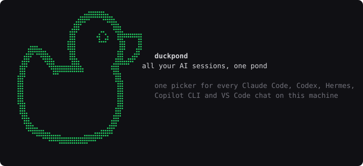
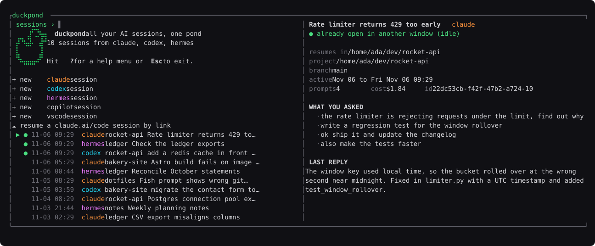
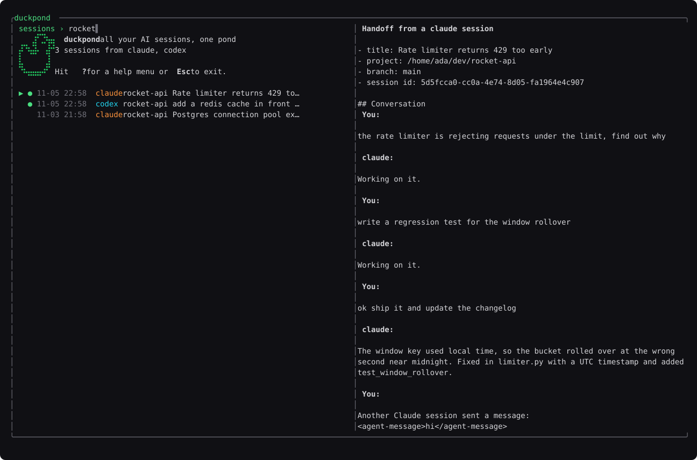
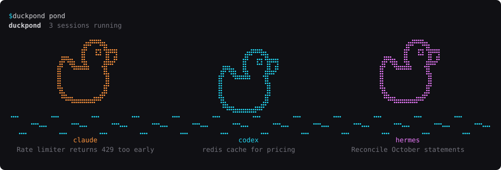
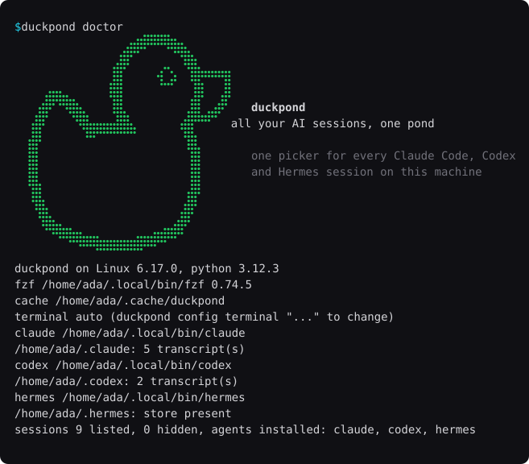
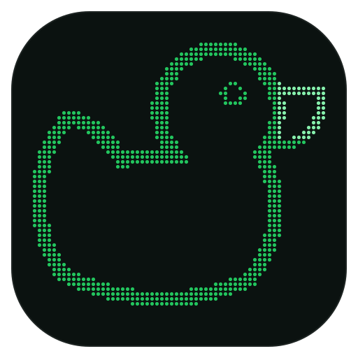

# duckpond



You rubber-duck with AI coding agents all day. Claude Code, Codex, Hermes, Copilot CLI, Copilot Chat in VS Code: each one keeps its own history, and each one only shows you the sessions for the folder you launched it from. After a week you have a pond full of ducks and no idea which one you were talking to.

**duckpond** is one small, dependency-free entry point for all of them. The `duckpond` command (or `aisp` for short) lists every session from every agent across every project, gives each one a title and a preview of what you asked and what the duck said back, and resumes the one you pick in the right directory with the right agent. It can hand a conversation from one duck to another, and it never lets your conversations leave the machine.



Type to search. Ctrl-P shows the whole transcript:



A VS Code chat shows as open while its window is open and the chat was used in the last 15 minutes, and busy while Copilot is still answering. Resuming a VS Code chat opens the workspace in VS Code and tells you which chat to pick from its history, since VS Code has no command-line way to open one chat. Handing off to VS Code runs `code chat` with the opening prompt; handing off to Copilot CLI starts it with the prompt.

Keep `duckpond pond` open on a second screen. It is a heads-up display in the spirit of btop: it fills the terminal with a pond box on top, where every running agent is a duck, and tiled panels below, each titled the btop way with its toggle key: a network-style graph of tokens in (per second) and tokens out (per minute), both log scaled, as one-minute averages; a context box with a graph of context in use and a meter per session against its 200k or 1M window; and totals: sessions, prompts, tokens and cost for today and all time, cache hit rate, per-agent share of output, and today's cost, prompts and output per active hour. Every duck blinks and paddles about; busy ones bob and ripple, idle ones drift slowly, hop and sometimes quack. Subagents, whether Claude Code Agent calls or Hermes delegations, paddle behind their parent as ducklings. Under each duck is its card: status, for how long, and how much of the last ten minutes it spent working; title; directory and branch; uptime, prompts, cost and cache hit rate; tokens in and out with live rates and a sparkline; its ducklings; the tool it is running right now; and your last prompt. On a short terminal the cards shrink to status, title, tokens and tool. Keys 1 to 4 toggle the pond, tokens, context and totals boxes and the rest reflow to fill the space; the choice is remembered. `+` and `-` change the refresh interval, r refreshes, q or Esc leaves, and `duckpond last` resumes the newest session when you want to jump back in:



*All screenshots are rendered from generated sample data, never from real sessions.*

## Light by design

The whole point is that it costs almost nothing to have around.

- **No dependencies.** Python's standard library plus the fzf binary. No pip packages, no Node, no Electron, no daemon.
- **About 1,400 lines of Python**, 92 KB of code. The icons are the biggest thing in the package.
- **Fast.** Listing every session on this machine takes about 60 ms and 25 MB of memory, because duckpond remembers how far into each transcript it has read and only scans the new bytes. fzf itself idles at under 4 MB.
- **Nothing running in the background.** It only exists while the picker is open. Close it and it is gone.
- **Nothing to configure** to get started. Install, run `duckpond`, done. The two settings there are, your terminal and which pond boxes to show, have sensible defaults.

## Features

- One list for all agents and all projects, newest first, with a green dot on sessions that are open right now
- Search as you type across agent, title, your prompts, replies, branch and directory
- Preview pane: project, branch, active dates, prompt count, cost, the prompts you typed and the last reply
- Resume in the session's project directory, or wherever you last typed `!cd` inside it
- Hand off: export a session's conversation to a private markdown file and open a different agent on it in the same directory
- Live refresh while sessions are writing, without re-reading whole transcripts
- Fork, start a new session in a row's project, pull down a claude.ai/code session, hide rows, copy ids

| Key | Action |
| --- | --- |
| Enter | Resume the session with its agent |
| Ctrl-O | Hand off to another agent (pick the target, it opens with the conversation as context) |
| Ctrl-F | Resume as a fork with a new session id (Claude; others resume) |
| Ctrl-P | Show the full transcript in the preview pane |
| Ctrl-N | New session of that row's agent in that row's directory |
| Ctrl-T | List cloud sessions for that row's directory (`claude --teleport`) |
| Ctrl-X | Hide the row |
| Ctrl-U | Unhide everything |
| Ctrl-Y | Copy the session id |
| Ctrl-R | Refresh |
| ? | The guide, inside the picker (F1 works too) |

`duckpond help` prints the same guide in the terminal. Don't feel like typing `duckpond`? `aisp` does exactly the same thing. Outside the picker: `duckpond pond` is the live dashboard, `duckpond last` resumes your most recent session (`duckpond last codex` the most recent Codex one, any words filter like the search bar), `duckpond list --json` prints everything for scripts, `duckpond doctor` checks the setup.

Type an agent name to filter to it, for example `codex`, `vscode` or `hermes rocket`.

## Requirements

| | Needed | Notes |
| --- | --- | --- |
| Python | 3.9 or newer | No Python packages; duckpond is standard library only. Contributors: `pip install -e .[dev]` adds pytest |
| fzf | 0.44 or newer | The installer fetches it if missing. Otherwise `brew install fzf`, `apt install fzf`, `winget install fzf` or a [release binary](https://github.com/junegunn/fzf/releases) |
| An agent | any of Claude Code, Codex, Hermes, GitHub Copilot CLI, VS Code with Copilot Chat | duckpond lists whatever it finds; the command (`claude`, `codex`, `hermes`, `copilot`, `code`) must be on `PATH` to resume |
| For the installer | `curl` or `wget`, and `python3 -m venv` | Debian and Ubuntu: `sudo apt install python3-venv`. Windows: PowerShell 5.1 or newer |
| Optional | `wl-copy`, `xclip` or `xsel` on Linux | Only for Ctrl-Y copy id. macOS and Windows have `pbcopy` and `clip` built in |

Linux, macOS and Windows are supported. Windows Terminal is used for `--window` when present, otherwise cmd.

## Install

One line. It creates a private virtualenv, fetches fzf if you do not have it, registers an "AI Sessions" app with an icon, and runs a health check.

Linux and macOS:

```sh
curl -fsSL https://raw.githubusercontent.com/Vizim/duckpond/main/install.sh | sh
```

Windows (PowerShell):

```powershell
irm https://raw.githubusercontent.com/Vizim/duckpond/main/install.ps1 | iex
```

Then:

```sh
duckpond            # in the current terminal
duckpond --window   # in a new terminal window
duckpond doctor     # check agents, stores, fzf and the cache
```



Remove it just as easily. This takes the virtualenv, the command and the launcher. The cache with your session previews stays unless you answer yes at the prompt or add `--purge`:

```sh
curl -fsSL https://raw.githubusercontent.com/Vizim/duckpond/main/install.sh | sh -s -- --uninstall --purge
```

```powershell
& ([scriptblock]::Create((irm https://raw.githubusercontent.com/Vizim/duckpond/main/install.ps1))) -Uninstall
```

Prefer your own tooling? `pipx install git+https://github.com/Vizim/duckpond` works too, as does `pip install .` from a clone; install [fzf](https://github.com/junegunn/fzf#installation) 0.44 or newer yourself in that case.

`--window` uses the first terminal it finds on Linux (kitty, alacritty, foot, wezterm, gnome-terminal, konsole, xfce4-terminal, xterm), Terminal.app on macOS and Windows Terminal or cmd on Windows.

### App icon and launcher



The installer runs `duckpond install-launcher`, which puts an "AI Sessions" app with the icon where your desktop looks for apps, so you can pin it to a dock, panel or taskbar:

- Linux: a desktop entry in `~/.local/share/applications` plus hicolor icons
- macOS: `~/Applications/Duckpond.app`, a tiny bundle that runs `duckpond --window`
- Windows: a Start Menu shortcut with the `.ico`, pin it to the taskbar from there

`duckpond uninstall-launcher` removes it. The icon ships in the package as SVG, PNG, ICO and ICNS under `duckpond/assets` if you want to use it elsewhere, for example in a status bar widget.

## Configuration

Settings live in `~/.config/duckpond/config.ini` (`%APPDATA%\duckpond\config.ini` on Windows) and are changed with `duckpond config`:

```sh
duckpond config                          # show settings and where the file is
duckpond config terminal "alacritty -e"  # use alacritty for --window and the app launcher
duckpond config terminal ""              # back to auto-detect
```

Environment variables override the file for one run:

| Variable | Default | Meaning |
| --- | --- | --- |
| `DUCKPOND_TERMINAL` | per OS | Command that opens a terminal window running the program after it, e.g. `alacritty -e` or `gnome-terminal -- {cmd}` |
| `DUCKPOND_CACHE` | `~/.cache/duckpond` | Index, previews, handoff files and the hidden list |
| `CLAUDE_CONFIG_DIR` | `~/.claude` | Where Claude Code keeps its transcripts |
| `CODEX_HOME` | `~/.codex` | Where Codex keeps its rollouts |
| `HERMES_HOME` | `~/.hermes` | Where Hermes keeps its SQLite store |
| `COPILOT_HOME` | `~/.copilot` | Where Copilot CLI keeps its session events |
| `DUCKPOND_VSCODE_DIR` | VS Code's `User` directory for your platform | Where VS Code keeps Copilot Chat sessions (`workspaceStorage/*/chatSessions`) |

## Scripting

`duckpond list --json` prints every session as JSON (agent, id, directory, project, branch, title, last activity, prompt count, cost, first prompt, last reply), newest first. `duckpond list codex rocket` applies the same search the picker does. `duckpond export AGENT ID FILE` writes one conversation as markdown.

## Handing off between agents

Press Ctrl-O on a session and pick the target agent. The picker writes the conversation (your prompts and the agent's replies, newest 200 KB if it is long) to a markdown file in the cache, then starts the target in the session's directory with an opening prompt that points at the file. Claude and Codex take that prompt on the command line. Hermes cannot take an opening prompt and stay interactive, so the picker starts `hermes chat` and puts the prompt on your clipboard to paste.

## Teaching the agents about duckpond

```sh
duckpond install-skills
```

copies a `SKILL.md` into each installed agent's skills folder (`~/.claude/skills/duckpond`, `~/.codex/skills/duckpond`, `~/.hermes/skills/duckpond`, `~/.copilot/skills/duckpond`). With it, an agent that receives a handoff knows to read the file and continue rather than start over, knows to point you at Ctrl-O instead of hand-copying context when you ask to switch agents, can answer "what was I working on" from `duckpond list --json`, and can run `duckpond doctor` when something looks off. This is the one thing duckpond writes under an agent's home, it is opt-in, and `duckpond uninstall-skills` removes it. The skill text is in `duckpond/skills/duckpond/SKILL.md`.

## Privacy

Your conversations with these agents are some of the most personal data on your computer. duckpond treats them that way.

- **Nothing leaves the machine.** There is no server, no telemetry, no update check and no analytics. The only socket it opens is fzf's control port on `127.0.0.1`, protected by a random key for each launch, which the picker uses to refresh its own list.
- **Agent stores are read, never written.** Transcript files are opened read-only and the Hermes database is opened in SQLite read-only mode. Hiding a session writes its id to duckpond's own cache. Nothing in `~/.claude`, `~/.codex`, `~/.hermes`, `~/.copilot` or VS Code's storage is ever modified or deleted, with one opt-in exception: `duckpond install-skills` adds a `skills/duckpond/SKILL.md` folder there and `uninstall-skills` removes it.
- **No credentials.** duckpond does not read, store or pass along any token. Each agent signs in through its own flow. duckpond runs `claude`, `codex` or `hermes` exactly as you would in a shell.
- **The cache is yours and private.** `~/.cache/duckpond` holds session summaries, previews and any handoff exports. It is created with owner-only permissions (`0700` directory, `0600` files). `sh install.sh --uninstall` offers to remove it, or delete it by hand at any time; duckpond rebuilds it.
- **Handoffs are explicit.** Pressing Ctrl-O writes one conversation to a markdown file in the cache and opens the agent you chose on it. Which agent sees which conversation is always your keypress.
- **The one exception is Claude's own cloud feature.** Ctrl-T and the cloud-link row run `claude --teleport`, which talks to Anthropic on your behalf. It only runs when you press it.

The full list of paths touched and the threat model are in [SECURITY.md](SECURITY.md), along with how to report a vulnerability.

## How it works

`duckpond list` builds the list. For Claude and Codex it scans the JSONL transcripts and remembers how far it read, so a changed file costs only its new bytes. For Hermes it queries `state.db`. Each keystroke in fzf re-runs it with the query, so matching happens in Python and the list stays in time order. A thread in the picker watches the stores and pokes fzf over its listen port when something changes. Live Claude sessions come from its lock files, checked against the recorded process start time on Linux so a reused pid is not mistaken for a running session.

## Development

```sh
git clone https://github.com/Vizim/duckpond
cd duckpond
python -m pip install -e . pytest
python -m pytest -q
```

Tests run against generated sample stores, never your real sessions, and CI runs them on Linux, macOS and Windows. `python tests/sample_stores.py DIR` builds the same sample set to try the picker on; see CONTRIBUTING.md.

## License and trademarks

MIT. This is an independent project. Claude Code is a product of Anthropic, Codex of OpenAI and Hermes of Nous Research. Their names are used only to say which tools this picker works with. None of them built, endorse or are affiliated with it, and it ships none of their software: each agent is installed and signed into through its own official flow, and the picker only launches it.
